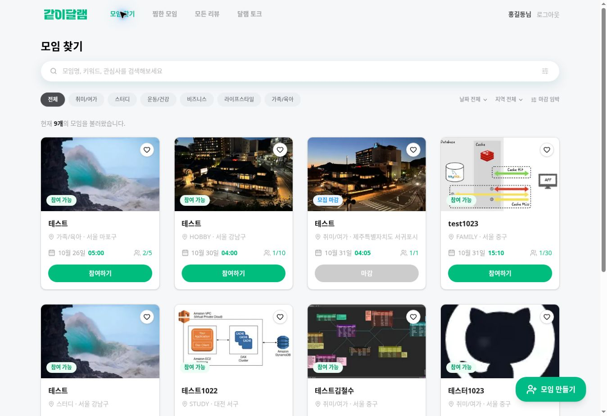
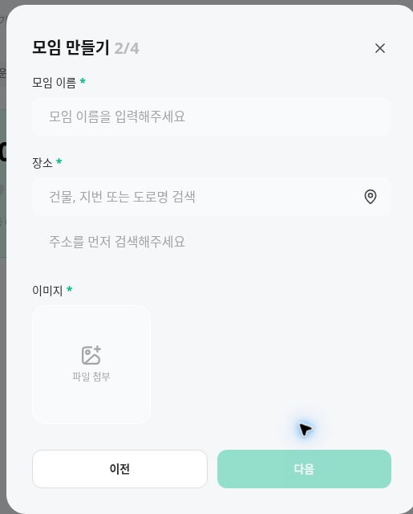
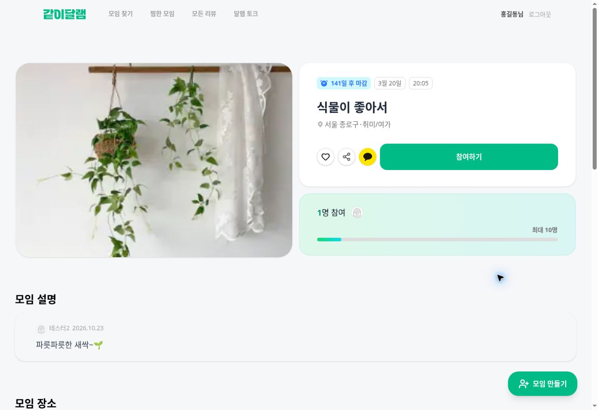
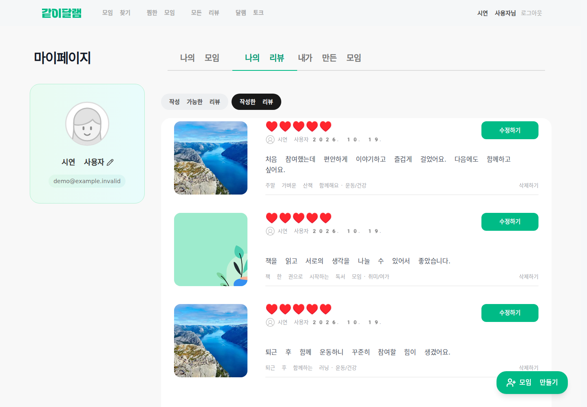
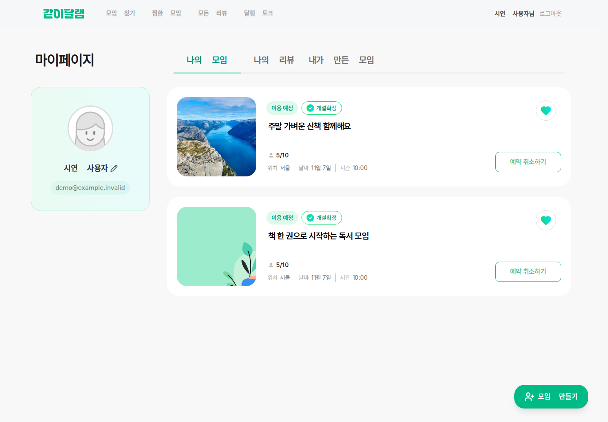
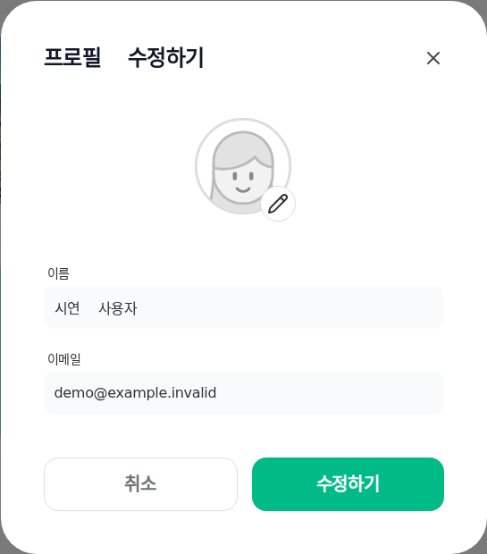

# 같이 달램 · 5:MEET

관심사에 맞는 모임을 찾고, 함께한 경험을 기록하는 소셜 모임 플랫폼입니다.

사용자가 다양한 카테고리의 모임을 생성하고, 관심 있는 모임을 검색하거나 참여하며, 찜하기와 리뷰를 통해 모임 활동을 관리할 수 있습니다.

**[서비스 바로가기](https://5-meet.vercel.app/)**



## 주요 기능

| 영역 | 제공 기능 |
| --- | --- |
| 인증 | 이메일 회원가입·로그인, 소셜 로그인, 로그아웃과 사용자 정보 관리 |
| 모임 탐색 | 카테고리, 키워드 검색, 날짜·지역 필터, 정렬, 추가 목록 조회 |
| 모임 생성 | 기본 정보·소개·일정 입력, 주소 검색, 이미지 업로드 |
| 모임 상세 | 일정·장소·참여 인원과 지도 확인, 찜하기, 참여·참여 취소, 주최자의 수정·삭제 |
| 찜한 모임 | 관심 모임 목록 조회와 찜 상태 변경 |
| 리뷰 | 리뷰 목록·필터·페이지 이동, 작성 가능한 리뷰 확인, 작성·수정·삭제 |
| 마이페이지 | 나의 모임·내가 만든 모임 조회, 추가 불러오기, 카드별 찜 상태 변경, 프로필 수정 |

모임 탐색과 상세 정보를 확인한 뒤, 로그인하여 참여·찜·리뷰와 마이페이지 기능을 이용할 수 있습니다.

## 화면 미리보기

최종 발표 자료에 사용한 화면입니다. 배포 화면에는 개발 중 등록한 테스트 모임이 포함되어 있으며, 리뷰·마이페이지 예시는 테스트 데이터로 구성했습니다.

| 모임 생성 | 모임 상세 |
| :---: | :---: |
|  |  |

**리뷰 관리 · 테스트 데이터**



| 마이페이지 · 테스트 데이터 | 프로필 수정 · 테스트 데이터 |
| :---: | :---: |
|  |  |

## 팀 구성 및 담당 기능

최종 발표 자료의 담당 범위를 기준으로 정리했습니다. 공통 UI 구현과 코드 리뷰를 통해 각 영역을 통합했습니다.

| 팀원 | 주요 담당 |
| --- | --- |
| 민기 · [carrbanog](https://github.com/carrbanog) | 인증·세션, 공통 UI·GNB, 모임 탐색 |
| 채원 · [chaewon127](https://github.com/chaewon127) | 모임 생성·상세, 참여 관리, 주최자의 모임 수정·삭제 |
| 유리 · [DevJamJam](https://github.com/DevJamJam) | 마이페이지·프로필, PR 검토·통합 관리 |
| 채연 · [chaeyeon41](https://github.com/chaeyeon41) | 리뷰 조회·작성·수정·삭제, 찜 목록 |

## 구현에서 고려한 점

### 프로필 이미지의 실제 표시 영역을 확인하고 저장

프로필 이미지의 원형 크롭은 원래 요구사항에 없었지만, 개발 기획 단계에서 사용자가 원하는 부분을 프로필에 담을 수 있도록 도입했습니다. 이미지 선택 후 원형 영역을 확인하며 위치와 크기를 조정할 수 있습니다. 프로필 이름과 이미지는 각각 변경하거나 함께 변경할 수 있습니다.

### 인증 요청과 토큰 갱신 흐름 공통화

서버의 인증 요청 처리를 공통 함수로 분리했습니다. 인증 요청에서 401 응답을 받으면 Refresh Token으로 갱신하고 원래 요청을 한 번 재시도하며, 갱신할 수 없는 경우 재로그인이 필요한 상태를 반환합니다.

관련 코드: [serverFetchWithTokenRefresh.ts](src/lib/api/serverFetchWithTokenRefresh.ts)

### 리뷰 변경 후 관련 데이터 갱신

리뷰 작성·수정·삭제 API를 연결하고, 변경 후 관련 쿼리 캐시를 갱신하도록 구성했습니다. 마이페이지의 작성한 리뷰 목록과 연동하고 로딩·오류 상태를 처리했습니다.

관련 PR: [리뷰 작성·수정·삭제 API 연동 #103](https://github.com/5meet/5-meet/pull/103)

### 공유받은 사용자도 정확한 모임 장소를 확인

모임 상세의 카카오 위치 공유에서 지역명과 실제 주소를 구분했습니다. PR 리뷰로 데이터 매핑부터 상세 화면의 props 전달까지 확인하고, 실제 모임 주소를 공유 요청에 전달하도록 보완했습니다.

관련 PR: [모임 상세 및 카카오 공유 #122](https://github.com/5meet/5-meet/pull/122)

## 기술 스택

| 구분 | 사용 기술 |
| --- | --- |
| 프레임워크·언어 | Next.js 16, React 19, TypeScript |
| 스타일·UI | Tailwind CSS 4, Base UI, Lucide React, Sonner |
| 서버 상태·API | TanStack Query, ky, Next.js Route Handlers |
| 폼·이미지 | React Hook Form, react-easy-crop |
| 외부 연동 | Google OAuth, Kakao 로그인·지도·공유 |
| UI 개발·테스트 | Storybook, MSW, Vitest, Testing Library, Playwright |
| 배포·패키지 관리 | Vercel, npm |

## 로컬 실행

### 1. 설치

Next.js 16을 지원하는 Node.js 20.9 이상과 npm이 필요합니다.

```bash
git clone https://github.com/5meet/5-meet.git
cd 5-meet
npm ci
```

### 2. 환경 변수 설정

프로젝트 루트에 `.env.local` 파일을 만들고 프로젝트용 API 주소와 발급받은 키를 설정합니다. 실제 키와 토큰은 저장소에 커밋하지 않습니다.

```dotenv
# 팀 경로를 포함한 백엔드 API 기본 주소. 끝의 /는 제외합니다.
NEXT_PUBLIC_CODEIT_API_URL=https://your-api-host/your-team-id

# enabled로 설정하면 개발용 MSW 핸들러를 활성화합니다.
NEXT_PUBLIC_API_MOCKING=disabled

# Google 로그인
NEXT_PUBLIC_GOOGLE_CLIENT_ID=your-google-client-id

# Kakao 지도·공유에 사용하는 JavaScript 키
NEXT_PUBLIC_KAKAO_MAP_KEY=your-kakao-javascript-key
NEXT_PUBLIC_KAKAO_JS_KEY=your-kakao-javascript-key

# Kakao 로그인 서버 설정
KAKAO_REST_API_KEY=your-kakao-rest-api-key
KAKAO_REDIRECT_URI=http://localhost:3000/api/auth/kakao/callback
# Kakao 앱에서 Client Secret을 사용하는 경우 설정
KAKAO_CLIENT_SECRET=
```

API 기본 주소는 팀에서 사용하는 백엔드 환경에 맞게 설정해야 합니다. 소셜 로그인·지도·공유는 각 제공자의 개발자 콘솔에 로컬 도메인과 Redirect URI를 등록해야 정상 동작합니다. MSW는 등록한 요청만 모킹하므로 전체 백엔드를 대체하지 않습니다.

### 3. 개발 서버 시작

```bash
npm run dev
```

브라우저에서 [localhost:3000](http://localhost:3000)을 엽니다.

## 개발 명령어

| 명령어 | 용도 |
| --- | --- |
| `npm run dev` | Next.js 개발 서버 |
| `npm run build` | 프로덕션 빌드 |
| `npm run start` | 빌드 결과 실행 |
| `npm run lint` | ESLint 검사 |
| `npm run storybook` | Storybook 실행 · 포트 6006 |
| `npm run build-storybook` | Storybook 정적 빌드 |

별도 단위 테스트 설정은 `vitest.unit.config.ts`, Storybook 브라우저 테스트 설정은 `vitest.config.ts`에서 관리합니다. 마이페이지의 화면·상태 검증 절차는 [나의 모임 검증 문서](tests/my-meetings/README.md)를 참고하세요.

## 폴더 구조

```text
src/
├── app/                 # 페이지·레이아웃·Route Handlers
├── features/            # 인증·모임·리뷰·찜·마이페이지 기능
├── components/          # 공통 UI 컴포넌트
├── lib/                 # API·인증·공통 유틸리티
└── mock/                # 개발용 MSW 설정
.storybook/              # Storybook 설정
public/                  # 이미지·아이콘·폰트
tests/                  # 기능별 검증 스크립트와 가이드
```

## 협업 흐름

이슈에서 작업 범위를 정하고 `feature/*` 브랜치에서 구현한 뒤 PR로 검토했습니다. 리뷰에서 확인한 내용을 보완하고 `develop`에 통합한 후 `main`으로 반영하는 흐름을 사용했습니다.
